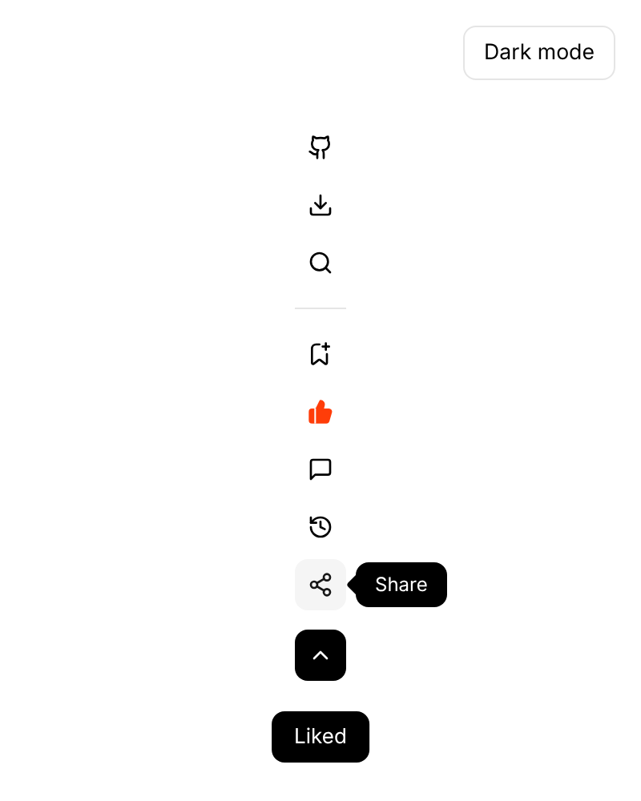
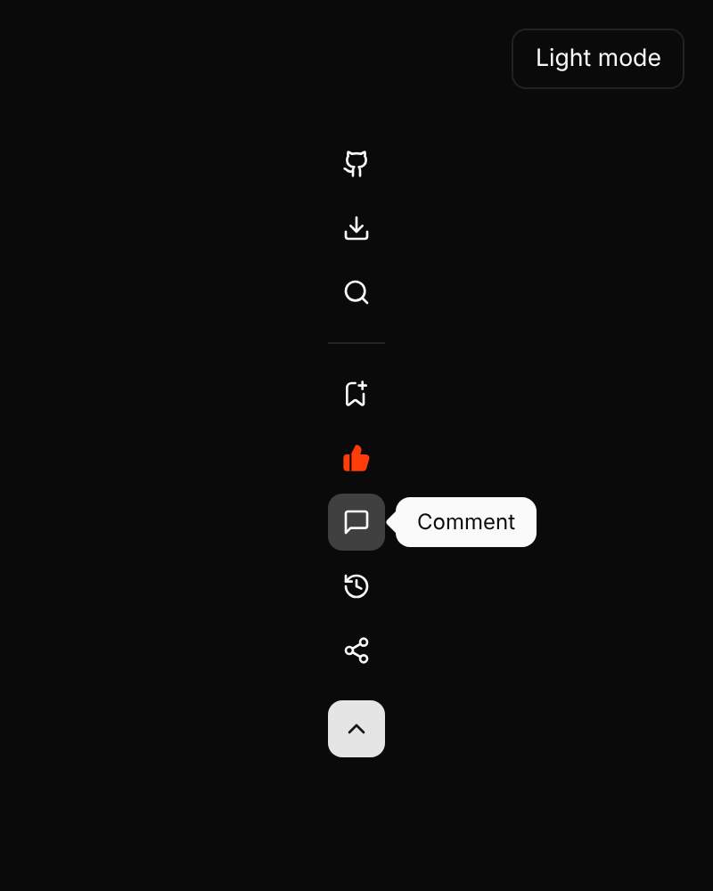

# Floating Menu

A collapsible vertical action rail for article and documentation pages, built in React.

The top group (GitHub, Download, Search) is always visible. The bottom group (Save, Like, Comment, History, Share) collapses with a height-and-fade transition, toggled by the chevron button. Each icon has a tooltip, the like button fills brand-orange when it's on, and the open/closed state is remembered between visits.

**[Live demo →](https://tanaka-1997.github.io/floating-menu/)**

<p>
  
  
</p>

## Usage

Copy `src/` into your project (or install from this repo) and render the component:

```jsx
import { FloatingMenu } from "floating-menu";

export function ArticleLayout({ children }) {
  return (
    <div style={{ display: "flex", gap: 32 }}>
      <FloatingMenu
        onGitHub={() => window.open("https://github.com/your/repo")}
        onDownload={handleDownload}
        onSearch={openSearch}
        onSave={openSaveDialog}
        onLikeChange={(liked) => saveLike(liked)}
        onComment={scrollToComments}
        onHistory={openHistory}
        onShare={share}
      />
      <article>{children}</article>
    </div>
  );
}
```

Install straight from GitHub:

```bash
npm install github:tanaka-1997/floating-menu
```

Your bundler needs to handle JSX and CSS imports (Vite, Next.js and similar do this out of the box).

## Props

| Prop | Type | Default | Description |
| --- | --- | --- | --- |
| `onGitHub`, `onDownload`, `onSearch` | `() => void` | — | Handlers for the always-visible group |
| `onSave`, `onComment`, `onHistory`, `onShare` | `() => void` | — | Handlers for the collapsible group |
| `liked` | `boolean` | — | Controlled like state. Leave unset to let the component manage it |
| `onLikeChange` | `(liked: boolean) => void` | — | Called when the like button is toggled |
| `defaultOpen` | `boolean` | `true` | Whether the collapsible group starts open |
| `storageKey` | `string \| null` | `"floating-menu-open"` | `localStorage` key for the open state. Pass `null` to disable persistence |
| `className` | `string` | — | Extra class on the root `<aside>` |

## Theming

All colours are CSS custom properties scoped to `.fmenu`, so you can override them without touching the stylesheet:

```css
.fmenu {
  --fm-brand: #2a6fdb;       /* liked colour */
  --fm-radius: 6px;
  --fm-sticky-top: 80px;     /* distance from the top when the menu sticks */
}
```

Dark mode switches on when `.dark` is on the menu or any ancestor. Available tokens: `--fm-background`, `--fm-foreground`, `--fm-primary`, `--fm-primary-foreground`, `--fm-accent`, `--fm-accent-foreground`, `--fm-muted`, `--fm-border`, `--fm-ring`, `--fm-brand`, `--fm-radius`, `--fm-sticky-top`.

## Accessibility

- Every button has an `aria-label` and a tooltip on hover and keyboard focus
- The toggle exposes `aria-expanded`; collapsed buttons are hidden from assistive tech and removed from the tab order
- The like button uses `aria-pressed`
- Animations are turned off under `prefers-reduced-motion`

## Development

```bash
npm install
npm run dev      # demo at http://localhost:5173
npm run build    # static demo in dist/
```

Pushing to `main` deploys the demo to GitHub Pages.

## License

MIT
